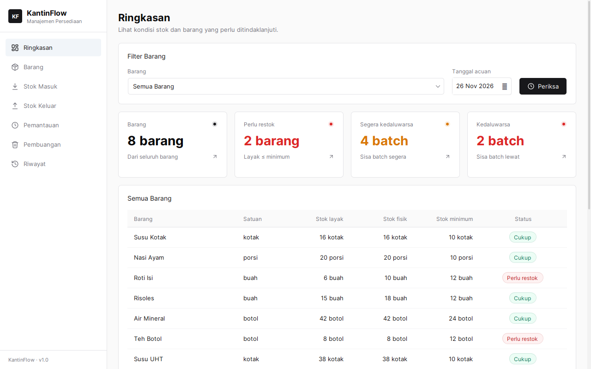
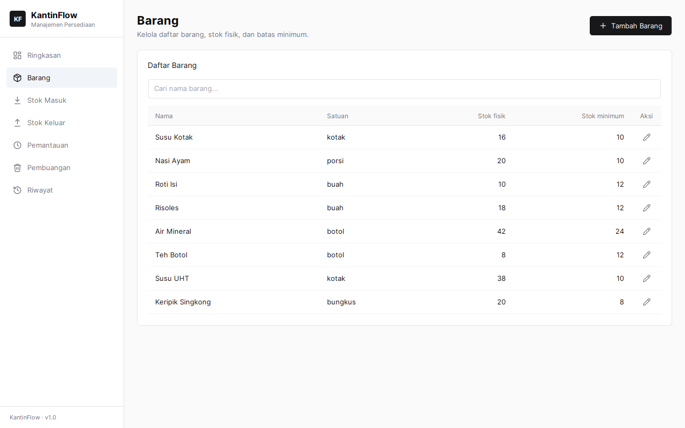
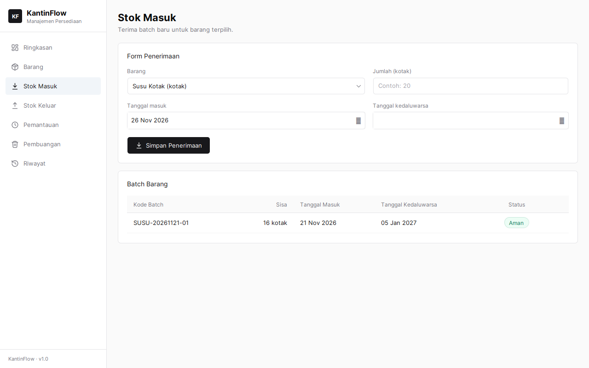
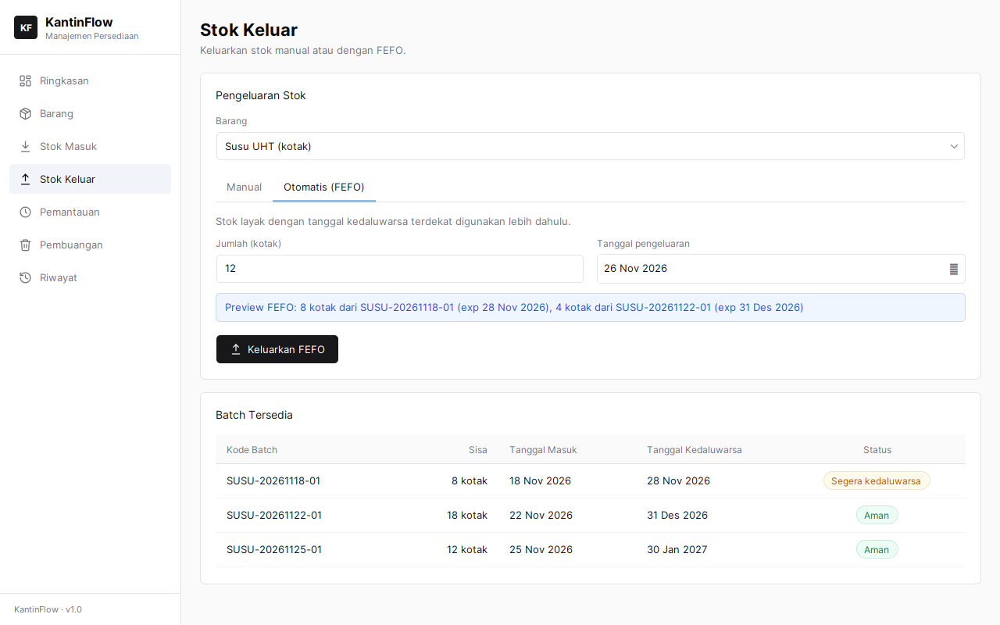
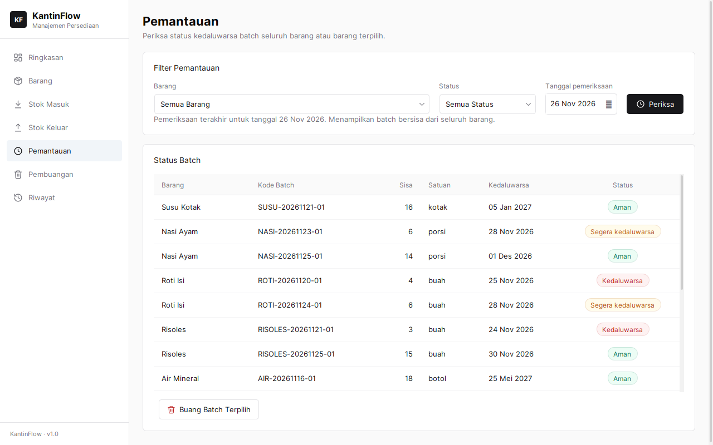
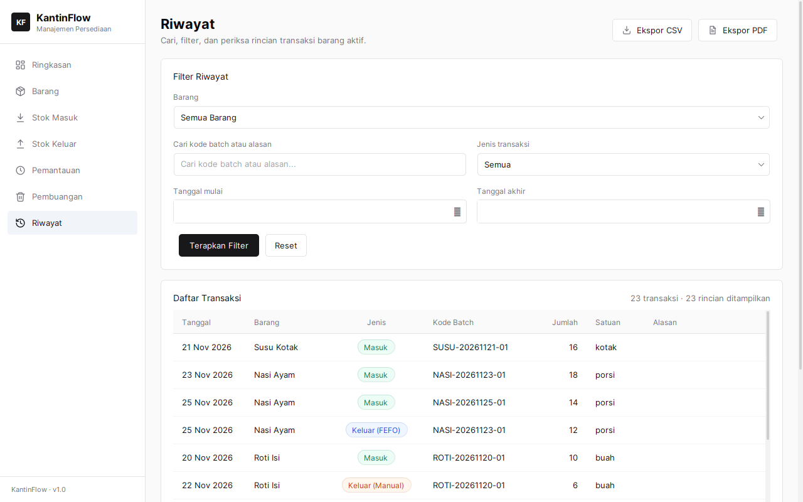
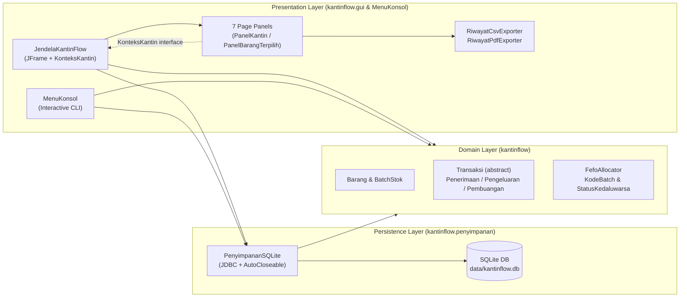

# KantinFlow PBO

**Desktop Inventory Management Application with Batch Tracking and FEFO Allocation**


KantinFlow PBO is a standalone Java desktop application for canteen inventory management built around **batch-level stock tracking** and **FEFO (*First Expired, First Out*)** allocation. Each inventory item holds multiple dated stock batches with intake date, expiry date, and remaining quantity; automatic stock-out allocates from the earliest-expiring eligible batch first while excluding expired and future-dated batches.

Developed originally as an academic Object-Oriented Programming (*Pemrograman Berorientasi Objek* / PBO) project, the application pairs a clean domain model and local SQLite persistence with a seven-view Java Swing desktop interface, an interactive console interface, an in-memory demo mode, and a 24-case automated regression suite.

> **Project Scope Note:** **KantinFlow PBO** is the standalone Java desktop implementation. It is separate from **KantinFlow SIM**, the full-stack web implementation. The desktop UI labels and Java domain identifiers are written in Indonesian to match the academic context.



---

## Key Features

- **Dashboard Overview (`Ringkasan`)** — Filter by item or inspect all items at a chosen reference date. Displays KPI cards for total items, restock alerts (usable stock ≤ minimum), expiring-soon batches (≤ 3 days), and expired batches, alongside expiry warning tables, full item status tables, and quick-navigation cards.
- **Item Master (`Barang`)** — Live name search, physical stock vs. minimum threshold table, dialog to add new items (preset or custom units), and dialog to configure minimum stock thresholds.
- **Stock-In (`Stok Masuk`)** — Receive new stock batches with automatically generated internal batch codes (`PREFIX-yyyyMMdd-NN`), date validation (expiry cannot precede intake date), and a live batch status table.
- **Manual & Automatic FEFO Stock-Out (`Stok Keluar`)** — Supports both single-batch manual stock-out (blocking expired batches) and automatic **FEFO** allocation with a real-time multi-batch allocation preview before saving.
- **Expiry Monitoring (`Pemantauan`)** — Filter remaining batches by item, expiry status (`Aman`, `Segera kedaluwarsa`, `Kedaluwarsa`), and inspection date, with sortable columns and a direct **Dispose Selected Batch** shortcut for expired stock.
- **Stock Disposal (`Pembuangan`)** — Record disposal of expired or damaged stock with confirmation dialogs. Expired batches default to `"Kedaluwarsa"` if no reason is provided; non-expired batches require an explicit disposal reason.
- **Transaction History & Reporting (`Riwayat`)** — Filter by item (or all items), batch code/reason search, transaction type, and date range. Export the currently filtered view to **CSV** (UTF-8 BOM, formula-injection protection, atomic write) or **PDF** (A4 landscape via Apache PDFBox with repeating table headers, page numbers, and embedded DejaVu Sans).
- **Desktop Ergonomics** — Modern Minimalist Zinc/Slate light theme powered by FlatLaf (`FlatLightLaf`) and Inter typography, responsive layouts supporting 100%–150% DPI scaling (`1280×800` default, `960×640` minimum), keyboard shortcuts (`Ctrl+1` through `Ctrl+7`), sortable table headers, pill status badges, and toast notifications.
- **Console & In-Memory Demo Modes** — Includes a 10-option interactive CLI (`MenuKonsol`) backed by SQLite and a 4-scenario in-memory demonstration (`demo`) that runs without touching any database file.

### Stock & FEFO Rules

- **Expiry status** on a reference date:
  - **Expired (`Kedaluwarsa`)**: expiry date is before the reference date.
  - **Expiring Soon (`Segera kedaluwarsa`)**: expiry date is within 0–3 days of the reference date.
  - **Safe (`Aman`)**: expiry date is more than 3 days after the reference date.
- **Usable stock (`Stok layak`)**: sum of remaining quantities across batches with `sisa > 0`, `tanggalMasuk <= referenceDate`, and status not expired.
- **FEFO ordering**: eligible batches sorted deterministically by expiry date, then intake date, then batch code (case-insensitive tie-breaker).
- **Restock alert (`Perlu restok`)**: triggered when usable stock ≤ minimum stock threshold.

---

## Visual Tour

### Item Master (`Barang`)
Search items, compare physical stock against minimum thresholds, add new items, and adjust restock limits.



### Stock-In (`Stok Masuk`)
Record incoming stock batches with automatic `PREFIX-yyyyMMdd-NN` batch code generation and expiry validation.



### Automatic FEFO Stock-Out (`Stok Keluar`)
Real-time multi-batch FEFO allocation preview showing exact quantities drawn from the earliest-expiring eligible batches first.



### Expiry Monitoring (`Pemantauan`)
Inspect batch expiry statuses across all items at any reference date and jump straight to disposal for expired batches.



### Transaction History & Export (`Riwayat`)
Audit stock-in, manual stock-out, FEFO stock-out, and disposal entries across items with filtered CSV and PDF export.



---

## Technology Stack

| Component | Technology | Role |
| --- | --- | --- |
| Language & Runtime | **Java (JDK 25)** | Core domain, CLI, GUI, and tests (verified on Temurin 25.0.5) |
| Desktop UI | **Java Swing** + **FlatLaf 3.8** | Desktop shell, `FlatLightLaf` Zinc/Slate theme, custom defaults |
| Icons & Typography | **FlatLaf Extras 3.8**, **JSVG 2.2.0**, **Inter 3.19** | Vector SVG icons (`FlatSVGIcon`) and Inter UI font |
| Date Picker | **LGoodDatePicker 11.2.1** | Calendar date selection across forms and filters |
| Persistence | **SQLite** + **sqlite-jdbc 3.54.1.0** | Local relational database via JDBC with explicit transactions |
| Reporting | **Apache PDFBox 3.0.8** (`pdfbox`, `pdfbox-io`, `fontbox`, `commons-logging`) | A4 landscape PDF report generation with embedded DejaVu Sans |
| Scripting | **PowerShell** (`setup.ps1`) & **Batch** (`run-gui.cmd`) | Dependency bootstrap, compilation, and Windows launcher |

> *Note:* `setup.ps1` also verifies `swing-toast-notifications-1.0.4.jar` and `xchart-3.8.8.jar` in `lib/`, though the current codebase uses an internal Swing toast implementation (`ToastNotification.java`) and does not import either library.

---

## Technical Architecture

KantinFlow PBO is structured into three cohesive Java packages with strict separation between domain rules, JDBC persistence, and Swing presentation:



### OOP Highlights

- **Encapsulation** — `Barang` guards its batch collection with `Collections.unmodifiableList(...)` and validates all invariants; `BatchStok.kurangiSisa(int)` is package-private so only domain transaction classes can mutate remaining stock.
- **Abstraction** — `Transaksi` defines the abstract contract for stock movements; `KonteksKantin` decouples all seven Swing panels from SQLite/JDBC; `PanelKantin` and `PanelBarangTerpilih` abstract page refresh and unsaved-form confirmation.
- **Inheritance** — `PenerimaanStok`, `PengeluaranStok`, and `PembuanganStok` extend `Transaksi`; GUI pages extend `PanelKantin` or `PanelBarangTerpilih`; `StatCard` extends `CardPanel`; domain and persistence errors use `StokTidakCukupException` and `PenyimpananException`.
- **Polymorphism** — `List<Transaksi>` is processed uniformly across CLI, GUI history, CSV/PDF exporters, and SQLite persistence; `JendelaKantinFlow` manages all seven views through `Map<String, PanelKantin>`.

For full class diagrams, persistence design, and UI architecture details, see [docs/ARCHITECTURE.md](docs/ARCHITECTURE.md).

---

## Installation & Local Development

### Prerequisites

- **JDK 25** (`java` and `javac` available on `PATH`, tested on Eclipse Temurin 25.0.5)
- **Windows PowerShell** (used by `setup.ps1` and `run-gui.cmd`)
- Internet access once to download JAR dependencies into `lib/`

### 1. Download Dependencies

Run from the repository root:

```powershell
powershell -ExecutionPolicy Bypass -File .\setup.ps1
```

To verify existing JARs in `lib/` without downloading:

```powershell
powershell -ExecutionPolicy Bypass -File .\setup.ps1 -CheckOnly
```

### 2. Quick Launch on Windows (GUI)

```cmd
run-gui.cmd
```

`run-gui.cmd` verifies dependencies via `setup.ps1 -CheckOnly`, compiles all Java sources into `out/`, copies `src/main/resources/` (FlatLaf properties, SVG icons, DejaVu fonts), and launches the Swing GUI with `--enable-native-access=ALL-UNNAMED`.

### 3. Manual Compile & Run

```powershell
# Compile sources and copy resources
$src = Get-ChildItem -Path src\main\java -Recurse -Filter *.java -File
javac -encoding UTF-8 -cp "lib/*" -d out $src.FullName
Copy-Item -Path "src\main\resources\*" -Destination out -Recurse -Force

# Launch Desktop GUI
java --enable-native-access=ALL-UNNAMED -cp "out;lib/*" kantinflow.Main gui

# Launch Interactive Console Mode
java --enable-native-access=ALL-UNNAMED -cp "out;lib/*" kantinflow.Main

# Run In-Memory Demo (4 scenarios, no database required)
java -cp "out;lib/*" kantinflow.Main demo
```

> **Linux / macOS note:** Replace the Windows classpath separator `;` with `:` (e.g., `-cp "out:lib/*"`) and download the JARs listed in `setup.ps1` into `lib/`. If an older JDK does not recognize `--enable-native-access=ALL-UNNAMED`, omit that flag.

---

## Data Storage & Configuration

- **Default database:** `data/kantinflow.db` (relative to the working directory; created automatically if absent).
- **Custom or isolated demo database:** Set the `KANTINFLOW_DB` environment variable before launching to avoid modifying the repository's sample database:

```powershell
$env:KANTINFLOW_DB = "data/kantinflow-demo.db"
.\run-gui.cmd
```

- **Schema & reliability:** `PenyimpananSQLite` enables `PRAGMA foreign_keys = ON` and `PRAGMA busy_timeout = 5000`, uses parameterized `PreparedStatement` queries, wraps multi-step writes in explicit `commit()`/`rollback()` transactions, seeds a default `Susu Kotak` item on empty databases, and automatically migrates legacy databases missing the `stok_minimum` column.
- **Sample database in repo:** `data/kantinflow.db` ships with synthetic Indonesian canteen sample data (15 items, 28 batches, 59 transactions) so the app is immediately explorable after cloning. Close the app before copying or backing up the SQLite file.

---

## Testing & Quality Checks

The project includes a standalone 24-case regression suite in [`src/test/java/kantinflow/DomainBaselineTest.java`](src/test/java/kantinflow/DomainBaselineTest.java) covering FEFO allocation order, expiry boundaries, transaction atomicity, SQLite round-trips, corruption handling, concurrent access, console state recovery, and Swing GUI regression checks (lazy refresh, sorting, keyboard shortcuts, accessibility, high-DPI layout).

Run the test suite from the repository root after compiling `out/`:

```powershell
New-Item -ItemType Directory -Force -Path out-test | Out-Null
javac -encoding UTF-8 -cp "out;lib/*" -d out-test src\test\java\kantinflow\DomainBaselineTest.java
java --enable-native-access=ALL-UNNAMED -cp "out-test;out;lib/*" kantinflow.DomainBaselineTest
```

Expected result: `Lulus: 24, Gagal: 0`.

---

## Known Limitations

- **Single-user local persistence:** Built for a single desktop workstation using local SQLite; there is no user authentication, role-based access control, or network synchronization.
- **Light theme only:** Uses the Zinc/Slate light theme (`FlatLightLaf`). No dark theme toggle is currently implemented.
- **Item metadata immutability in UI:** Item names and units cannot be edited from the GUI after creation (only minimum stock thresholds can be updated).
- **Source-based launch:** The project does not currently bundle a fat JAR or native OS installer; running requires JDK 25 and the `lib/` dependencies fetched by `setup.ps1`.

---

## Credits & Third-Party Attribution

- [FlatLaf](https://www.formdev.com/flatlaf/) (`flatlaf`, `flatlaf-extras`, `flatlaf-fonts-inter`) — Apache License 2.0
- [sqlite-jdbc](https://github.com/xerial/sqlite-jdbc) — Apache License 2.0
- [Apache PDFBox](https://pdfbox.apache.org/) (`pdfbox`, `pdfbox-io`, `fontbox`) & [Commons Logging](https://commons.apache.org/proper/commons-logging/) — Apache License 2.0
- [LGoodDatePicker](https://github.com/LGoodDatePicker/LGoodDatePicker) — MIT License
- [JSVG](https://github.com/weisJ/jsvg) — MIT License
- **DejaVu Sans** fonts bundled in `src/main/resources/kantinflow/fonts/` for PDF export — Bitstream Vera / Arev / Public Domain (see [`LICENSE-DejaVu.txt`](src/main/resources/kantinflow/fonts/LICENSE-DejaVu.txt))

---

## License

This repository's source code is publicly visible for educational and portfolio review. **No open-source license has been added yet**; all rights remain reserved by the author unless a `LICENSE` file is explicitly added.
