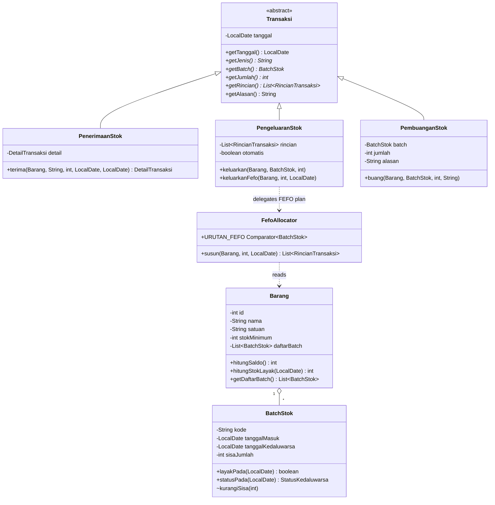

# KantinFlow PBO — Technical Architecture & OOP Design

This document describes the verified package structure, object-oriented design, domain rules, SQLite persistence layer, and Java Swing UI architecture of **KantinFlow PBO** (`v1.0`).

---

## 1. Package & Module Overview

```text
src/
├─ main/
│  ├─ java/kantinflow/
│  │  ├─ Main.java                     # CLI/GUI/Demo entry point & KANTINFLOW_DB resolution
│  │  ├─ MenuKonsol.java               # 10-option interactive console interface
│  │  ├─ Barang.java                   # Item aggregate root (batches, balance, usable stock)
│  │  ├─ BatchStok.java                # Stock batch entity (dates, remaining qty, expiry status)
│  │  ├─ Transaksi.java                # Abstract transaction contract
│  │  ├─ PenerimaanStok.java           # Stock-in transaction (creates batch)
│  │  ├─ PengeluaranStok.java          # Manual & automatic FEFO stock-out transaction
│  │  ├─ PembuanganStok.java           # Expired/damaged stock disposal transaction
│  │  ├─ DetailTransaksi.java          # Stock-in detail value object
│  │  ├─ RincianTransaksi.java         # Per-batch allocation line item
│  │  ├─ FefoAllocator.java            # Pure FEFO allocation planner & comparator
│  │  ├─ KodeBatch.java                # Internal batch code generator (PREFIX-yyyyMMdd-NN)
│  │  ├─ StatusKedaluwarsa.java        # Expiry status enum (KEDALUWARSA, SEGERA_KEDALUWARSA, AMAN)
│  │  ├─ StokTidakCukupException.java  # Domain unchecked exception for insufficient stock
│  │  ├─ penyimpanan/
│  │  │  ├─ PenyimpananSQLite.java     # JDBC persistence, schema init, migration, transactions
│  │  │  └─ PenyimpananException.java  # Persistence unchecked exception
│  │  └─ gui/
│  │     ├─ JendelaKantinFlow.java     # Main JFrame shell, sidebar, CardLayout, KonteksKantin impl
│  │     ├─ KonteksKantin.java         # Narrow interface decoupling panels from SQLite
│  │     ├─ PanelKantin.java           # Abstract Scrollable page base class
│  │     ├─ PanelBarangTerpilih.java   # Abstract item-scoped page with unsaved-form guard
│  │     ├─ PanelRingkasan.java        # Dashboard KPI cards, alerts, overview table
│  │     ├─ PanelBarang.java           # Item master, search, add & min-stock dialogs
│  │     ├─ PanelStokMasuk.java        # Stock-in form & batch table
│  │     ├─ PanelStokKeluar.java       # Manual & FEFO stock-out tabs + live FEFO preview
│  │     ├─ PanelPemantauan.java       # Expiry monitoring filter, sortable table, disposal jump
│  │     ├─ PanelPembuangan.java       # Stock disposal workflow with confirmation dialog
│  │     ├─ PanelRiwayat.java          # Multi-item history filter + CSV/PDF export triggers
│  │     ├─ Tema.java, Ui.java         # FlatLightLaf Zinc/Slate theme & DPI scaling tokens
│  │     ├─ CardPanel.java, StatCard.java, Badge.java, BadgeRenderer.java
│  │     ├─ TabelKantin.java, PemilihTanggal.java, FormatTanggal.java
│  │     ├─ EmptyState.java, DialogKonfirmasi.java, Notifikasi.java, ToastNotification.java
│  │     ├─ RiwayatCsvExporter.java    # UTF-8 BOM CSV writer with formula neutralization
│  │     └─ RiwayatPdfExporter.java    # Apache PDFBox A4 landscape report writer
│  └─ resources/kantinflow/
│     ├─ KantinFlow.properties         # FlatLaf custom UI defaults
│     ├─ icons/                        # Vector SVG icons rendered via FlatSVGIcon
│     └─ fonts/                        # DejaVu Sans TTF fonts + LICENSE-DejaVu.txt
└─ test/
   └─ java/kantinflow/
      └─ DomainBaselineTest.java       # 24 automated domain, SQLite, CLI, and GUI tests
```

---

## 2. Class Hierarchy & OOP Principles



### Verified OOP Examples in Source

1. **Encapsulation**
   - `Barang` keeps `id`, `nama`, `satuan`, `stokMinimum`, and `daftarBatch` `private`, validates all inputs in constructors/setters, and returns `Collections.unmodifiableList(daftarBatch)` so callers cannot bypass domain rules.
   - `BatchStok.kurangiSisa(int)` is intentionally **package-private** (`void kurangiSisa(int jumlah)`), restricting stock deductions to domain transaction classes (`PengeluaranStok`, `PembuanganStok`) inside `package kantinflow`.
   - `PenyimpananSQLite` encapsulates the JDBC `Connection`, SQL queries, and transaction lifecycle behind domain-typed methods.

2. **Abstraction**
   - `Transaksi` is an abstract base class defining the shared contract (`getJenis()`, `getBatch()`, `getJumlah()`, `getRincian()`, `getAlasan()`) for all stock movement types.
   - `KonteksKantin` is an interface defining the narrow boundary between GUI panels and `JendelaKantinFlow`, ensuring no GUI panel directly imports or calls `PenyimpananSQLite`.
   - `PanelKantin` (abstract, `extends JPanel implements Scrollable`) defines the shared page lifecycle (`perbarui()`, `adaIsianBelumDisimpan()`, `getAksiHeader()`), while `PanelBarangTerpilih` abstracts item selection and unsaved-form confirmation for item-scoped forms.

3. **Inheritance**
   - **Domain transactions:** `PenerimaanStok`, `PengeluaranStok`, and `PembuanganStok` inherit from `Transaksi`.
   - **GUI page hierarchy:** `PanelRingkasan`, `PanelBarang`, `PanelPemantauan`, and `PanelRiwayat` extend `PanelKantin`; `PanelStokMasuk`, `PanelStokKeluar`, and `PanelPembuangan` extend `PanelBarangTerpilih` (which extends `PanelKantin`).
   - **Custom Swing components & exceptions:** `StatCard extends CardPanel extends JPanel`; `Badge extends JLabel`; `TabelKantin extends JTable`; `StokTidakCukupException` and `PenyimpananException` extend `RuntimeException`.

4. **Polymorphism**
   - `List<Transaksi>` is handled polymorphically in `Main.cetakRiwayat`, `MenuKonsol`, `PanelRiwayat`, and `PenyimpananSQLite.muatRiwayat` via overridden `getJenis()`, `getRincian()`, `getJumlah()`, and `getAlasan()`.
   - `JendelaKantinFlow` stores all seven pages in `Map<String, PanelKantin>` and refreshes/navigates them uniformly through `PanelKantin` methods.
   - Interface polymorphism is used via `KonteksKantin` (`JendelaKantinFlow`), `TableCellRenderer` (`BadgeRenderer`), `Scrollable` (`PanelKantin`), and `AutoCloseable` (`PenyimpananSQLite`).

---

## 3. Domain Rules & FEFO Allocation

- **Deterministic FEFO ordering (`FefoAllocator.URUTAN_FEFO`):**
  1. `tanggalKedaluwarsa` ascending (earliest expiry first)
  2. `tanggalMasuk` ascending (earliest intake first)
  3. `kode` ascending (case-insensitive, then exact string tie-breaker)
- **Eligibility (`BatchStok.layakPada(LocalDate)`):** A batch is eligible for FEFO allocation only if `sisaJumlah > 0`, `!tanggalMasuk.isAfter(referenceDate)`, and `statusPada(referenceDate) != StatusKedaluwarsa.KEDALUWARSA`.
- **Two-phase atomicity:** `FefoAllocator.susun(...)` computes the complete allocation plan and verifies total usable stock *before* `PengeluaranStok.keluarkanFefo(...)` mutates any `BatchStok`. If usable stock is insufficient, `StokTidakCukupException` is thrown with zero partial mutations.
- **Batch code generation (`KodeBatch`):** Normalizes item names (diacritics stripped, uppercase alphanumeric first word up to 12 chars) into `PREFIX-yyyyMMdd-NN`, with sequence numbers computed across all stored batches (including depleted ones) for that item and intake date.

---

## 4. Persistence Architecture (`PenyimpananSQLite`)

- **Database engine:** Local SQLite accessed via `org.sqlite.JDBC` (`sqlite-jdbc-3.54.1.0.jar`).
- **Connection hardening:**
  - `PRAGMA foreign_keys = ON`
  - `PRAGMA busy_timeout = 5000`
  - Automatic parent directory creation for file-backed paths (supports `:memory:` for unit tests).
  - Clean connection closure if initialization fails.
- **Schema:**
  - `barang(id, nama, satuan, stok_minimum CHECK >= 0)`
  - `batch(id, barang_id, kode, tanggal_masuk, tanggal_kedaluwarsa, sisa_jumlah CHECK >= 0, UNIQUE(barang_id, kode))`
  - `transaksi(id, barang_id, jenis, tanggal, alasan)`
  - `rincian_transaksi(id, transaksi_id, batch_id, jumlah CHECK > 0, UNIQUE(transaksi_id, batch_id))`
- **Automatic migration:** On startup, `migrasiStokMinimum()` inspects `PRAGMA table_info(barang)` and adds `stok_minimum` inside a transaction if opening an older database.
- **Query & transaction safety:**
  - `muatSemuaBarang()` loads all items and batches in at most 2 SQL queries (avoiding N+1 queries).
  - Multi-table writes (`simpanBarang`, `simpanTransaksi`, `simpanStokMinimum`) use explicit `setAutoCommit(false)` / `commit()` / `rollback()`.
  - Public persistence methods are `synchronized` to guard concurrent access to the shared SQLite connection.

---

## 5. Desktop UI & Export Architecture

- **Theme & DPI Scaling:** `Tema.pasang()` registers `kantinflow/KantinFlow.properties`, installs `FlatInterFont` (fallback `Segoe UI`), and applies `FlatLightLaf` with Zinc/Slate color tokens defined in `Ui.java`. Dimensions scale dynamically via `Ui.skala(...)` for 100%–150% DPI displays.
- **Shell & Lazy Refresh:** `JendelaKantinFlow` uses a fixed sidebar (`220px` base width), `CardLayout` content area, `FadeOverlay` glass pane for page transitions, and a dirty-panel set (`panelPerluSegar`) so inactive pages only refresh when visited.
- **Keyboard Accessibility:** Global `WHEN_IN_FOCUSED_WINDOW` shortcuts `Ctrl+1` through `Ctrl+7` switch directly between the seven pages.
- **Safe Exports:**
  - `RiwayatCsvExporter` writes UTF-8 with BOM (`\uFEFF`), RFC-compliant quoting, leading-apostrophe neutralization for spreadsheet formula prefixes (`=`, `+`, `-`, `@`), and atomic temp-file replacement (`ATOMIC_MOVE`).
  - `RiwayatPdfExporter` builds A4 landscape reports using Apache PDFBox 3.0.8 with embedded DejaVu Sans (`PDType0Font`), repeating table headers, page footers, and atomic temp-file replacement.

---

## 6. Automated Verification (`DomainBaselineTest`)

`src/test/java/kantinflow/DomainBaselineTest.java` is a zero-framework standalone test runner executing 24 regression suites:

- **Domain & FEFO (Tests 1–10):** Manual stock-out, expired batch rejection, expiry boundary dates, FEFO sort order, future-dated batch exclusion, `hitungStokLayak` consistency, insufficient stock handling, mutation atomicity, date consistency, input trimming & duplicate batch code rejection.
- **SQLite & CLI (Tests 11–19):** In-memory SQLite round-trip, demo mode compatibility, multi-item/multi-batch ordering, multi-line FEFO history persistence, corrupt date/DB handling, constructor failure cleanup, SQLite transaction rollback, multi-threaded concurrent SQLite access, and `MenuKonsol` in-memory recovery on save failure.
- **Swing GUI Regression (Tests 20–24):** Lazy panel refresh, duplicate submission guard, clean window shutdown, table sorting & monitoring-to-disposal handoff, sidebar focus/accessibility/`Ctrl+1..7` shortcuts/`FadeOverlay`, `Badge`/`BadgeRenderer`/`StatCard` consistency, and high-DPI control height/responsive KPI grid checks.
