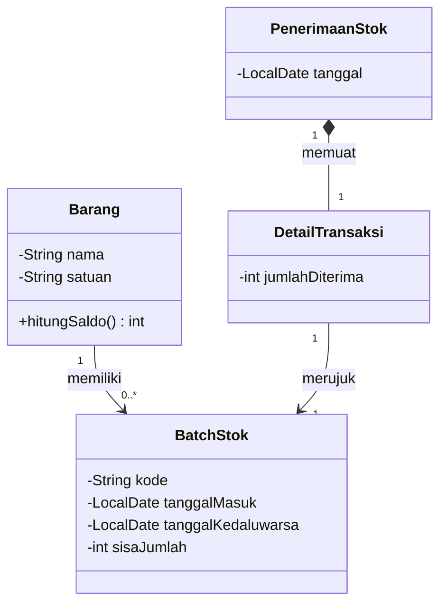

# Rancangan Stok Masuk

Status tahap ini adalah **rancangan**. Implementasi dan pengujian Java menyusul setelah rancangan disepakati.

## Alur pertama

Petugas mencatat satu batch Susu Kotak dengan jumlah 5 kotak. Sistem memvalidasi isian, menambahkan batch dan satu transaksi penerimaan ke riwayat, lalu menampilkan saldo barang. Jika jumlah 0, sistem menolak penerimaan sebelum menambahkan batch atau riwayat.

## Hubungan antarkelas

Satu barang dapat belum punya batch. Setiap batch dalam cakupan ini dibuat oleh satu detail penerimaan. `Barang` menghitung saldo dari jumlah sisa seluruh batch. `DetailTransaksi` menyimpan jumlah asli yang diterima agar riwayat mencatat 5 kotak sekalipun sisa batch berkurang pada tahap berikutnya.

Untuk demo pertama, `Main` menyiapkan data, memanggil alur penerimaan, dan menampilkan hasil. Validasi jumlah dan aturan pencatatan berada pada alur domain sehingga berlaku juga ketika dipanggil tanpa konsol.

## Skenario uji

Jalankan berurutan dengan barang Susu Kotak yang sama.

| Skenario | Masukan | Hasil yang diharapkan |
| --- | --- | --- |
| Terima batch dari stok awal 0 | Kode `SUSU-A`, 5 kotak, tanggal masuk dan kedaluwarsa valid | Satu batch tercatat, saldo 5 kotak, satu catatan riwayat |
| Tolak penerimaan berikutnya | Kode `SUSU-B`, 0 kotak, tanggal valid | Muncul pesan “Jumlah harus lebih dari 0”. Saldo tetap 5 kotak, batch dan riwayat masing-masing tetap satu |

## Hasil Uji Demo

Demo berhasil dikompilasi dengan `javac` dan dijalankan di konsol.

| Percobaan | Hasil aktual |
| --- | --- |
| Terima 5 kotak Susu Kotak pada batch `SUSU-A` | Penerimaan berhasil. Saldo menjadi 5 kotak, dengan 1 batch dan 1 catatan riwayat. |
| Coba terima 0 kotak pada batch `SUSU-B` | Muncul pesan “Jumlah harus lebih dari 0”. Saldo tetap 5 kotak, dengan 1 batch dan 1 catatan riwayat. |

## Acuan laporan

- **Template Laporan PBO Primakara** menjadi acuan sementara untuk struktur laporan. Sampul dan checklist bertuliskan UTS. Konfirmasi rubrik UAS untuk jumlah kelas, konsep PBO, GUI, dan penyimpanan.
- **KantinFlow_Laporan_PBO_Java** menjadi referensi proses dan model lama. Isi bagian implementasi dan pengujian berdasarkan hasil versi Java yang dibuat ulang.
- **KantinFlow SIM** menjadi referensi contoh penerimaan 5 kotak dan penolakan jumlah 0.
