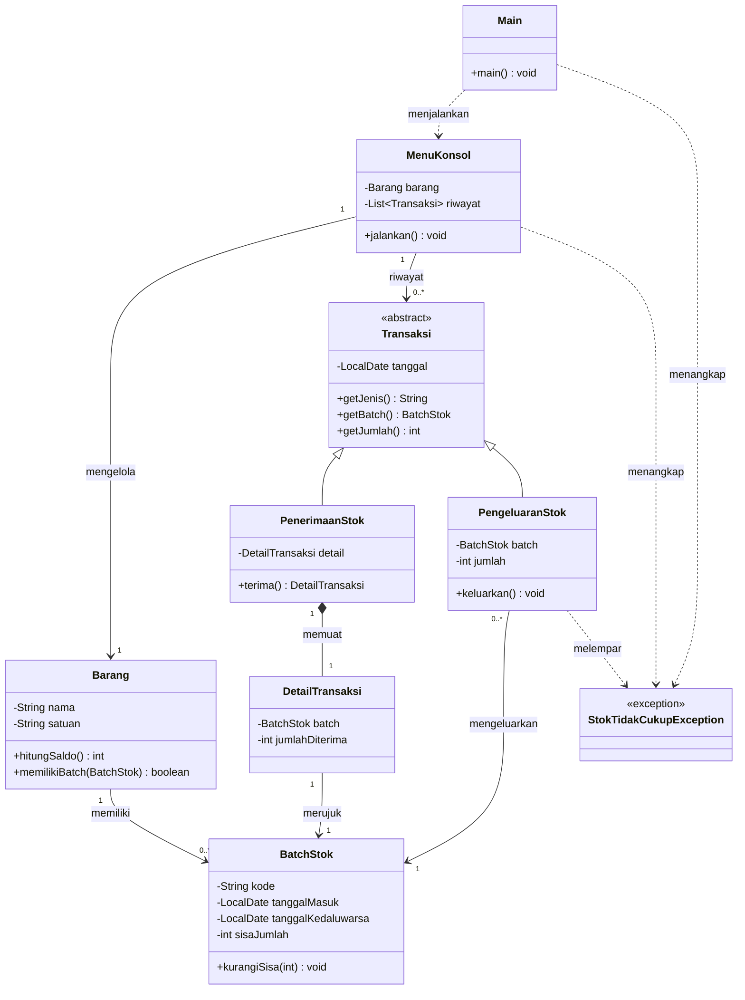

# Rancangan Stok Masuk dan Pengeluaran

Status tahap ini adalah **diimplementasikan** untuk penerimaan stok, pengeluaran dari satu batch, dan menu konsol interaktif. Data disimpan di memori. GUI, database, dan pemilihan batch otomatis berdasarkan kedaluwarsa belum termasuk.

## Alur penerimaan

Petugas mencatat satu batch Susu Kotak dengan jumlah 5 kotak. Sistem memvalidasi isian, menambahkan batch dan satu transaksi penerimaan ke riwayat, lalu menampilkan saldo barang. Jika jumlah 0, sistem menolak penerimaan sebelum menambahkan batch atau riwayat.

## Alur pengeluaran

Petugas memilih satu batch, lalu menentukan jumlah yang dikeluarkan. Sistem memvalidasi bahwa batch tersebut milik barang, jumlah lebih dari 0, dan sisa batch mencukupi. Jumlah nol atau negatif ditolak dengan `IllegalArgumentException`. Jika jumlah melebihi sisa, alur melempar `StokTidakCukupException`. Hanya setelah semua validasi lolos, `BatchStok.kurangiSisa()` dipanggil dan transaksi pengeluaran dicatat ke riwayat. Jika validasi gagal, sisa batch dan riwayat tidak berubah.

## Penanganan exception

`PengeluaranStok.keluarkan()` melempar `StokTidakCukupException` saat jumlah yang diminta melebihi sisa batch. Exception dilempar sebelum `kurangiSisa()` dan sebelum objek pengeluaran dicatat, sehingga kegagalan tidak mengubah stok. Validasi jumlah `<= 0` tetap menggunakan `IllegalArgumentException`.

`Main` menangkap `StokTidakCukupException` secara spesifik pada skenario 4 dan menampilkan pesan yang memuat jumlah diminta serta sisa tersedia. `IllegalArgumentException` pada skenario penerimaan tetap ditangani terpisah.

## Riwayat transaksi

`PenerimaanStok` dan `PengeluaranStok` sama-sama turunan abstrak `Transaksi`, sehingga `Main` dapat menyimpan keduanya dalam `List<Transaksi>` tanpa `List<Object>`. Riwayat menampilkan jenis transaksi, kode batch, dan jumlah melalui antarmuka yang sama.

`DetailTransaksi` menyimpan jumlah asli yang diterima. Setelah 2 kotak dikeluarkan, catatan penerimaan tetap 5 kotak, sedangkan sisa batch dan saldo berubah menjadi 3 kotak. `PengeluaranStok` menyimpan jumlah pengeluaran sebesar 2 kotak.

## Menu konsol

`Main` tanpa argumen menjalankan menu interaktif untuk satu barang Susu Kotak dengan stok awal 0. Pilihan menu:

1. Terima stok
2. Keluarkan stok dari batch yang dipilih
3. Lihat saldo dan riwayat
4. Keluar

Penerimaan meminta kode batch, jumlah, tanggal masuk, dan tanggal kedaluwarsa. Tanggal memakai format `yyyy-MM-dd`. Jika jumlah bukan angka atau tanggal salah format, program menampilkan pesan dan kembali ke menu tanpa mengubah data. Pengeluaran menampilkan batch yang tersedia, lalu meminta kode batch dan jumlah; validasi domain tetap dijalankan. Demo empat skenario tetap tersedia dengan `java -cp out kantinflow.Main demo`.

## Hubungan antarkelas



Satu barang dapat belum punya batch. Setiap batch dalam cakupan ini dibuat oleh satu detail penerimaan. `Barang` menghitung saldo dari jumlah sisa seluruh batch. `BatchStok` menjaga `sisaJumlah` tetap privat dan hanya mengubahnya melalui `kurangiSisa()`, yang menolak jumlah tidak positif atau jumlah yang melebihi sisa.

Untuk demo ini, `Main` menyiapkan data, memanggil alur penerimaan dan pengeluaran, lalu menampilkan hasil. Validasi dan aturan pencatatan berada pada alur domain sehingga berlaku juga ketika dipanggil tanpa konsol.

## Skenario uji

Jalankan berurutan dengan barang Susu Kotak yang sama.

| Skenario | Masukan | Hasil yang diharapkan |
| --- | --- | --- |
| Terima batch dari stok awal 0 | Kode `SUSU-A`, 5 kotak, tanggal masuk dan kedaluwarsa valid | Satu batch tercatat, saldo 5 kotak, satu catatan riwayat |
| Tolak penerimaan berikutnya | Kode `SUSU-B`, 0 kotak, tanggal valid | Muncul pesan “Jumlah harus lebih dari 0”. Saldo tetap 5 kotak, batch dan riwayat masing-masing tetap satu |
| Keluarkan dari batch terpilih | Batch `SUSU-A`, 2 kotak | Saldo 3 kotak, jumlah batch tetap 1, riwayat 2 catatan; penerimaan tetap 5 kotak dan pengeluaran 2 kotak |
| Tolak pengeluaran melebihi sisa | Batch `SUSU-A`, 4 kotak | `StokTidakCukupException` menampilkan pesan “Stok tidak cukup: diminta 4 kotak, tersedia 3 kotak”. Saldo tetap 3 kotak, batch tetap 1, riwayat tetap 2 catatan |

## Hasil Uji Demo

Demo berhasil dikompilasi dengan `javac` dan dijalankan dengan perintah berikut.

```powershell
java -cp out kantinflow.Main demo
```

| Percobaan | Hasil aktual |
| --- | --- |
| Terima 5 kotak Susu Kotak pada batch `SUSU-A` | Penerimaan berhasil. Saldo 5 kotak, 1 batch, 1 catatan riwayat. |
| Coba terima 0 kotak pada batch `SUSU-B` | Muncul pesan “Jumlah harus lebih dari 0”. Saldo tetap 5 kotak, 1 batch, 1 catatan riwayat. |
| Keluarkan 2 kotak dari batch `SUSU-A` | Pengeluaran berhasil. Saldo 3 kotak, 1 batch, 2 catatan riwayat; penerimaan tercatat 5 kotak dan pengeluaran 2 kotak. |
| Coba keluarkan 4 kotak dari batch `SUSU-A` | `StokTidakCukupException` menampilkan “Stok tidak cukup: diminta 4 kotak, tersedia 3 kotak”. Saldo tetap 3 kotak, 1 batch, 2 catatan riwayat. |

Output aktual:

```text
KantinFlow - Demo Penerimaan dan Pengeluaran Stok
Barang: Susu Kotak
Stok awal: 0 kotak

Skenario 1 - Terima batch SUSU-A sebanyak 5 kotak
Batch SUSU-A tersimpan: 5 kotak
Tanggal masuk: 2026-11-17
Tanggal kedaluwarsa: 2026-12-17
Saldo: 5 kotak
Jumlah batch: 1
Jumlah riwayat: 1

Skenario 2 - Terima batch SUSU-B sebanyak 0 kotak
Jumlah harus lebih dari 0
Saldo: 5 kotak
Jumlah batch: 1
Jumlah riwayat: 1

Skenario 3 - Keluarkan 2 kotak dari SUSU-A
Pengeluaran SUSU-A tersimpan: 2 kotak
Saldo: 3 kotak
Jumlah batch: 1
Jumlah riwayat: 2
Riwayat transaksi:
- Penerimaan SUSU-A: 5 kotak
- Pengeluaran SUSU-A: 2 kotak

Skenario 4 - Coba keluarkan 4 kotak dari SUSU-A
Stok tidak cukup: diminta 4 kotak, tersedia 3 kotak
Saldo: 3 kotak
Jumlah batch: 1
Jumlah riwayat: 2
```

## Uji Menu Konsol

Menu dijalankan dengan `java -cp out kantinflow.Main` dan diuji dengan urutan penerimaan 5 kotak, pengeluaran 2 kotak, percobaan pengeluaran 4 kotak, lalu melihat saldo dan riwayat.

| Langkah | Masukan | Hasil aktual |
| --- | --- | --- |
| Pilih 1, terima stok | `SUSU-A`, `5`, `2026-11-17`, `2026-12-17` | Penerimaan berhasil; saldo 5 kotak, 1 batch, 1 riwayat |
| Pilih 2, keluarkan stok | `SUSU-A`, `2` | Pengeluaran berhasil; saldo 3 kotak, 1 batch, 2 riwayat |
| Pilih 2, keluarkan stok | `SUSU-A`, `4` | Pesan “Stok tidak cukup: diminta 4 kotak, tersedia 3 kotak”; state tidak berubah |
| Pilih 3, lihat saldo dan riwayat | - | Saldo 3 kotak, jumlah batch 1, jumlah riwayat 2 |
| Pilih 4, keluar | - | Program selesai |

Baris hasil aktual dari menu (header menu dan prompt yang berulang tidak ditampilkan ulang):

```text
Penerimaan berhasil: SUSU-A, 5 kotak. Saldo: 5 kotak
Pengeluaran berhasil: SUSU-A, 2 kotak. Saldo: 3 kotak
Stok tidak cukup: diminta 4 kotak, tersedia 3 kotak
Saldo: 3 kotak
Jumlah batch: 1
Jumlah riwayat: 2
Riwayat transaksi:
- Penerimaan SUSU-A: 5 kotak
- Pengeluaran SUSU-A: 2 kotak
Terima kasih. Program selesai.
```

Uji format salah juga dijalankan. Program menampilkan pesan berikut lalu kembali ke menu tanpa menambah batch atau riwayat:

```text
Jumlah harus berupa angka bulat.
Format tanggal tidak valid. Gunakan yyyy-MM-dd.
Saldo: 0 kotak
Jumlah batch: 0
Jumlah riwayat: 0
Riwayat transaksi: (kosong)
```

## Acuan laporan

- **Template Laporan PBO Primakara** menjadi acuan sementara untuk struktur laporan. Sampul dan checklist bertuliskan UTS. Konfirmasi rubrik UAS untuk jumlah kelas, konsep PBO, GUI, dan penyimpanan.
- **KantinFlow_Laporan_PBO_Java** menjadi referensi proses dan model lama. Isi bagian implementasi dan pengujian berdasarkan hasil versi Java yang dibuat ulang.
- **KantinFlow SIM** menjadi referensi contoh penerimaan 5 kotak dan penolakan jumlah 0.
